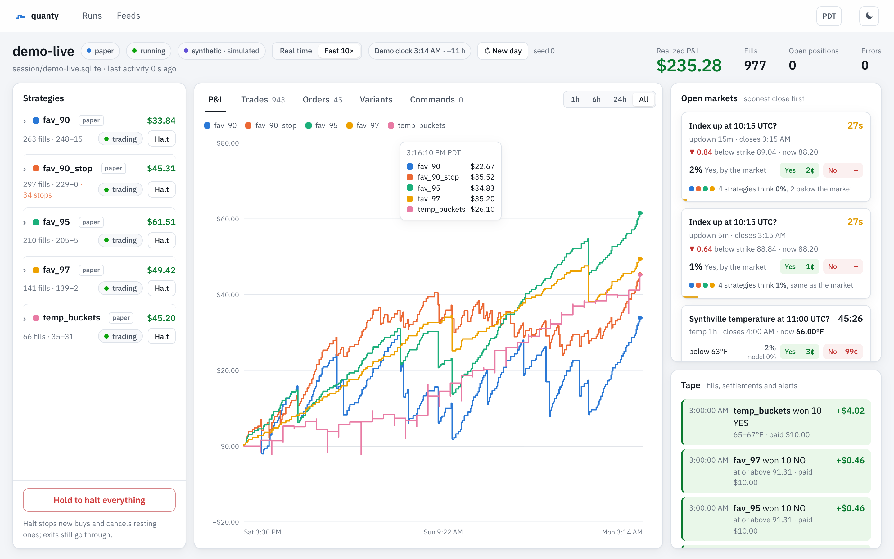

# quanty

A self-hosted framework for recording, backtesting, paper trading and live trading **repeated
prediction markets** on Kalshi and Polymarket US: crypto up/down windows, daily weather highs,
economic releases, any market that recurs on a schedule and settles against a known source.

Any binary contract works: up/down windows, ranges and ladders (a question with several outcomes
is a set of binaries sharing an event), thresholds. See [Writing strategies](docs/strategies.md#any-binary-market).

One strategy file runs unchanged in four modes. Only the broker behind it changes:

| Mode | Data | Orders |
|---|---|---|
| **backtest** | synthetic markets, or your recordings replayed | simulated fills: latency, book depth, queue position |
| **paper** | live feeds | simulated fills |
| **shadow** | live feeds | simulated fills, plus each order checked by the venue |
| **live** | live feeds | real orders, behind several layers of safety stops |

<picture>
  <source media="(prefers-color-scheme: dark)" srcset="docs/images/dashboard-dark.png">
  
</picture>

## Try it

```sh
git clone https://github.com/kwingram25/quanty && cd quanty
uv sync
uv run quanty demo --ui        # backtest four variants on synthetic markets, open the dashboard
uv run quanty demo --live      # or watch them paper trade in real time, with the controls
```

No keys, no setup. To start your own project, with a strategy skeleton, configs, API keys and the
files to deploy it:

```sh
uv run quanty init my-quanty          # a few questions; --yes for the defaults
cd my-quanty && uv run quanty list    # works there too: the first run sets everything up
docker compose up -d --build          # on a server: trader + dashboard, restarted on failure
```

[Getting started](docs/getting-started.md) goes step by step from experiments to recording real data,
paper trading, shadow trading and live trading; [Deploying](docs/deploying.md) covers servers.

## What's in it

- **Recording you can trust.** Every venue and feed message is stored exactly as received, with
  receive timestamps, including market discovery. Replays reproduce what a live run saw, in order.
  Per-minute health: gaps, reconnects, parse errors, receive lag p50/p99.
- **Venues.** Kalshi (any series: crypto, weather, economics; books rebuilt from deltas with
  sequence checks; CF Benchmarks indexes) and Polymarket US (repeated markets by slug template).
  Request signing, fee models, order APIs checked against the venues' published specs and real
  orders.
- **A realistic fill model.** Latency in event time, taker fills that walk the book, resting
  orders that wait their turn in the queue, post-only rejects; tunable from optimistic to
  conservative.
- **Risk in the core.** Order size, position, open risk, risk per correlated group, daily loss,
  halts: checked before any broker sees an order.
- **Live trading that stops rather than guesses.** Required size caps, `--arm`, self-disabling on
  repeated rejections or unknown order outcomes, an order journal that cleans up after a crash
  without touching anything else on the account. A fake exchange with fault injection for tests.
- **A dashboard.** P&L over time per strategy, every trade and order of a run (filtered, paged,
  downloadable as CSV), notable events and feed health, each platform's connection and your account balances, with controls for running sessions:
  halt, resume, disarm, kill switch, and editing a strategy's params (its size, say) while it runs.
  Optional password login for reaching it over HTTPS.
- **Private strategies.** Strategies load from folders in your own config, so your edge never has
  to live in this repo.

## Docs

- [Getting started](docs/getting-started.md): install to live, step by step
- [Writing strategies](docs/strategies.md): hooks, context, orders, signals, testing
- [Architecture](docs/architecture.md): how the pieces fit, and why one file runs everywhere
- [Live trading](docs/live-trading.md): the safety layers, and what to do before `--arm`

## Commands

| | |
|---|---|
| `quanty demo` | backtest a strategy on synthetic markets (`--ui` opens the dashboard) |
| `quanty backtest` | run an experiment on synthetic markets, or on recordings with `--data` |
| `quanty record`, `replay`, `feeds` | record venues and feeds; parse recordings back; feed kinds and health |
| `quanty paper`, `live` | run an experiment in real time (`live` needs `--arm`; `--ui` adds the dashboard) |
| `quanty ui` | the dashboard |
| `quanty promote` | move an instance between paper, shadow and live in its experiment file (`--now`: while running) |
| `quanty pull`, `changes` | bring a server's dashboard changes into your experiment files; list what a server holds |
| `quanty reload` | have a running session pick up its experiment file: new variants start, removed ones retire |
| `quanty init`, `deploy` | create a project; copy it to a Docker server, check it there and start it |
| `quanty doctor` | check a project before trading: config, keys, clock, venues, leftovers (read-only) |
| `quanty list`, `params` | strategies quanty can find, and their parameters |

## Layout

| | |
|---|---|
| `core/` | events, engine, risk, portfolio, ledger, strategy base class |
| `brokers/` | simulated (with `QueueModel`), shadow and live brokers |
| `feeds/` | transports, Coinbase and Binance adapters, recording, replay, health |
| `venues/` | Kalshi and Polymarket US; order APIs; the fake exchange |
| `ui/`, `control.py`, `web/` | the dashboard's API and live stream, the command channel to running sessions, and the React app |
| `signals.py`, `synthetic.py` | derived values rebuilt identically in replay; deterministic synthetic markets |
| `db/` | SQLAlchemy models and Alembic migrations |

## Development

```sh
uv sync
uv run pytest && uv run ruff check && uv run mypy
pre-commit install   # gitleaks, ruff, private-name guard
```

The dashboard is a React app in `web/` (TypeScript, Vite, Motion). Its build is committed to
`src/quanty/ui/dist`, so using quanty never needs Node; changing the dashboard does:

```sh
cd web && npm ci
npm run dev        # hot reload on :5173, proxying the API of a running `quanty ui` on :8765
npm run build      # before committing: CI checks the committed build matches the source
```

Database tables are SQLAlchemy models in `src/quanty/db/models.py`, migrated automatically when a
file is opened. After changing a model, `uv run alembic revision --autogenerate -m "..."`, review
the file, and run `uv run pytest tests/test_ledger.py`, which fails if models and migrations
differ. `scripts/check_private.py` blocks commits matching a denylist kept outside the repo
(`$QUANTY_DENYLIST`, default `~/.config/quanty/denylist.txt`).

## License

MIT
