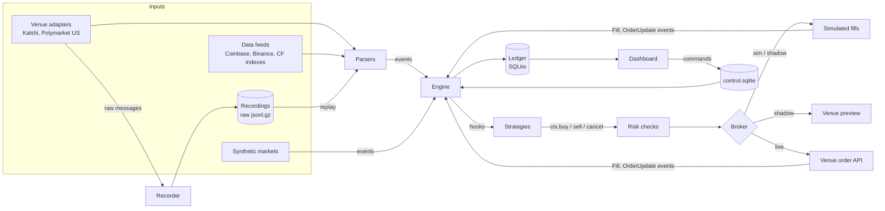

# Architecture

quanty is built around one idea: **everything is an event, and a strategy is a function of
events.** Venues, data feeds, the clock, fills and settlements all arrive as typed, timestamped
events in one stream. That is what lets one strategy file run unchanged in backtest, paper,
shadow and live, and lets a replay of recorded data reproduce a live run.

## Events

`core/events.py` defines the whole vocabulary: `MarketOpen`, `Book`, `MarketTrade`,
`MarketClose`, `Settled` for markets; `Quote`, `Trade`, `IndexValue`, `Observation`,
`Forecast`, `Release`, `Status` for external data; `Clock`; and `Fill` / `OrderUpdate` coming back from
brokers. Each carries `ts` (when quanty received it) and, where the source provides one, `src_ts`
(when the venue says it happened). The difference is the feed's lag, which the recorder measures.

## The engine

`core/engine.py` keeps a heap of events ordered by time and processes them one at a time:
market state first, then brokers (so a simulated order can fill against the book a strategy is
about to see), then strategies. Brokers schedule their own future events, such as an order
arriving at the venue `latency_ms` after it was sent, on the same heap, so simulated latency is
exact in event time.

In a backtest the engine runs as fast as the events allow. In a live session
(`feeds/session.py`) events are pushed in as they arrive and a 10 ms ticker advances the engine
on wall-clock time, so the same latency and clock events fire on time.

Every order passes `core/risk.py` before it reaches a broker: per-instance and account-wide
limits on order size, position, open risk, risk per correlation group and daily loss, plus the
halt switch. Rejections are orders too: they come back `REJECTED` with a reason and are in the
ledger.

## Brokers

A broker turns orders into `Fill` and `OrderUpdate` events. It never mutates an order; the
engine does, from those events.

- **`SimBroker`** fills against the recorded book: takers walk the levels at their prices,
  resting orders join the back of the queue at their price and fill as trades consume the queue
  ahead or the book moves through them, post-only orders that would cross are rejected.
  `QueueModel` switches choose how optimistic that is (when queue position is measured, whether
  cancels ahead count, what a trade through the price fills).
- **`ShadowBroker`** fills exactly like `SimBroker` and also sends each order to the venue's
  preview endpoint, or builds and signs it locally where there is none.
- **`LiveBroker`** sends real orders through `venues/orders.py`, polls resting orders for fills,
  re-reads after cancels (fills can race a cancel), and stops itself rather than guess. See
  [Live trading](live-trading.md).

## Venues and feeds

`feeds/` holds the transports (WebSocket with reconnects and overlap on replacement, REST
polling) and the recorder. `venues/` holds Kalshi and Polymarket US: market discovery for
repeated series, order-book reconstruction from snapshots and deltas with sequence checking, fee
models, request signing, and the order APIs.

Discovery responses are recorded in the same stream as books and trades. A replay therefore sees
markets open, strikes appear and results arrive in the order they did live, which matters for
strategies that act on the strike or on time left.

## Ledger and portfolio

`core/portfolio.py` keeps positions and realized P&L from fills and settlements only, so it can
always be rebuilt from the record. `core/ledger.py` writes orders, fills, settlements and log rows
to SQLite (write-ahead logging, so the dashboard reads while a session writes). Schemas are
SQLAlchemy models with Alembic migrations, applied automatically when a file is opened.

An experiment's paper and live sessions write one ledger, `data/session/<experiment>.sqlite`, one
run in the dashboard. Each order, fill and settlement records its broker's kind (`live` is real
money; `shadow`, `sim`), so one instance can be paper first and live later, and the dashboard
totals real and simulated P&L apart by row. A restarted session continues the run's order
numbering. Runs kept in the older `data/paper/` and `data/live/` folders still open; their kinds
come from each instance's broker.

## Dashboard and controls

`ui/` is a FastAPI app serving a JSON API and, per run, a WebSocket that pushes a fresh snapshot
whenever the ledger or the session's heartbeat changes, along with the rows that are new since the
last push. The React app in `web/` (built into `ui/dist`) renders it: open markets counting down to
their close, the P&L chart, a tape of fills, settlements and alerts, and toasts for anything that
needs attention. Every database is opened read-only. Controls go through `control.py`: the
dashboard writes commands to `data/control.sqlite`; each running session polls for its own, applies
them (halt, resume, disarm, arm, kill, and param changes, which it also saves per run so a restart
keeps them), records the outcome and publishes a heartbeat with its state,
including its open markets and the event clock (so countdowns stay right in sped-up demos).

## Determinism

The same inputs give the same results: synthetic markets are seeded, recordings keep raw bytes
and receive order, the engine orders ties deterministically, and simulated fills depend only on
events. That makes a backtest a regression test: change a parser or the fill model and compare
ledgers.
